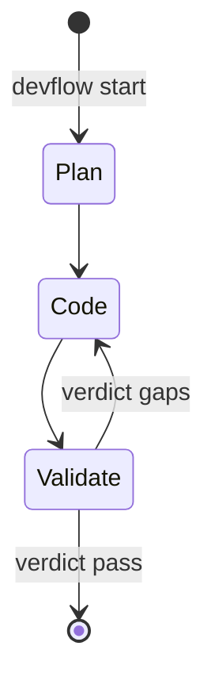

# State Machine

DevFlow persists one state file per active phase and walks a fixed pipeline.

| Stage | Primary result | Human interaction |
|---|---|---|
| `Plan` | Plan artifacts | Failure opens a gate |
| `Code` | Code plus configured external probes | Failure opens a gate |
| `Validate` | `DEVFLOW_RESULT` with `verdict: "pass"` or `"gaps"` | `supervise` mode gates every Validate; gaps return to Code; repeated failure opens a gate |

## Persisted State

State lives at `.devflow/state-NN.json`; an old single `.devflow/state.json`
is not read. The file records the current stage, phase, selected
agent, mode, gate status, start time, project root, and optional worktree.

`auto` runs unattended and finishes on a passing Validate, gating only on
repeated Validate failure and on unexpected failures. `supervise` also gates
every Validate. A finished run keeps the worktree and the `feature/phase-NN`
branch; integrating the branch is the operator's step.
