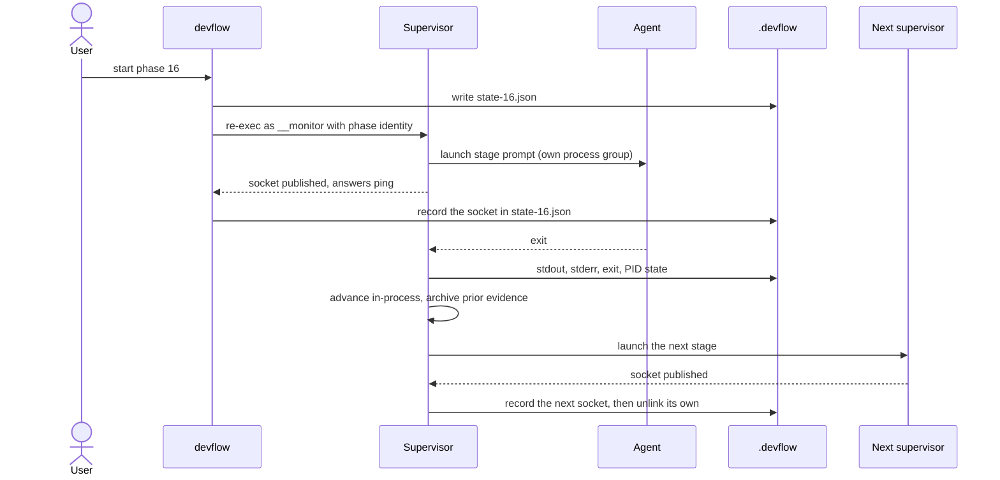
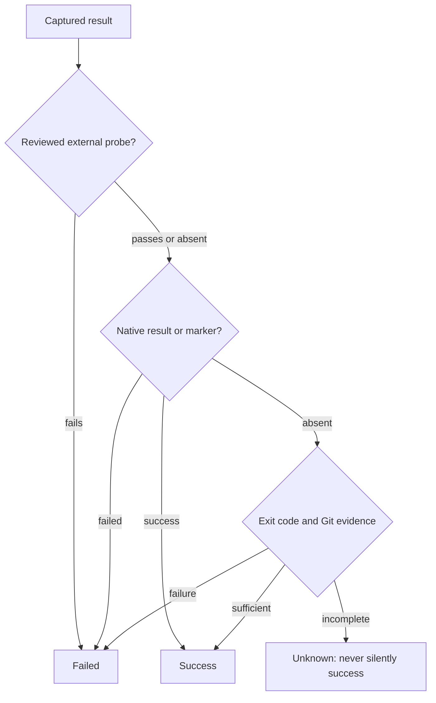

# Agent Lifecycle

Each stage of a phase runs under a detached supervisor (the hidden `__monitor`
process) so the agent can finish after the invoking terminal exits. The
supervisor owns the agent, answers liveness and stop requests on its own
socket, and when the agent exits runs the advance in-process: no separate
command is started to advance the phase.

## Completion Evidence

An external verification probe is allowed only when its exact command was
reviewed and supplied by the parent process. Validate additionally requires a
`pass` or `gaps` verdict; Ship reads its review artifact before it can proceed.
