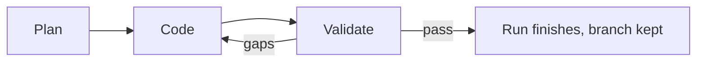

# DevFlow

**A durable execution loop for AI-assisted development.** DevFlow runs a
phase through planning, implementation, and validation while preserving the
evidence needed to understand what happened.

## Pipeline Overview

Plan and Code launch an agent in an isolated worktree. Validate requires an
explicit pass verdict; a `gaps` verdict loops back to Code. Failures open a
gate, repeated Validate failure opens a gate, and `--mode supervise` also
gates every Validate. A passing Validate ends the run and keeps the worktree
and the `feature/phase-NN` branch: DevFlow does not merge, tag, or open a pull
request, so integrating the branch is the operator's step.

## Quick Links

- [System Architecture](diagrams/system.md) — Runtime components and boundaries
- [State Machine](architecture/state-machine.md) — Stages, verdicts, and gates
- [Agent Model](architecture/agent-model.md) — Adapters and completion evidence
- [Quick Start](guides/quickstart.md) — Install and operate DevFlow

## Supported Agents

| Agent | CLI | Flag |
|-------|-----|------|
| Claude Code | `claude` | `--agent claude` |
| OpenAI Codex | `codex` | `--agent codex` |
| OpenCode | `opencode` | `--agent opencode` |

## Key Design Decisions

- **Opinionated, not universal** — Claude Code, Codex, and OpenCode are supported through one adapter contract today; DevFlow optimizes for the workflow decisions that hold up under real use, not maximum agent interchangeability.
- **Worktree-first** — each phase runs in its own Git worktree by default.
- **Evidence-first** — external probes, agent results, exits, and Git state are evaluated in order.
- **Never-silent failures** — failures open an actionable gate instead of stalling invisibly.
- **Durable operations** — phase state, captures, review artifacts, gates, and history survive restarts.
